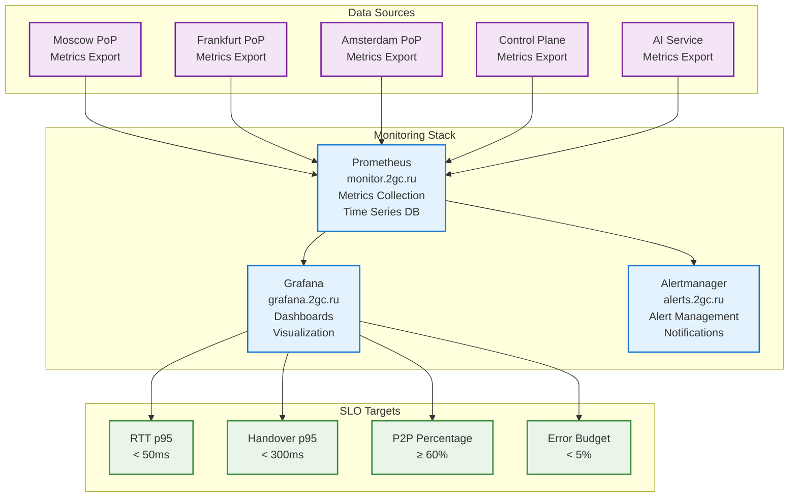

# CloudBridge Guard-Rails

**Анти-FP система самокоррекции и доверенной аналитики** для 2GC CloudBridge Global Network.

> **CloudBridge Guard-Rails** — перила, которые не дают упасть, обеспечивая защиту от ложных срабатываний, автоматическую коррекцию политик и доверенную аналитику для всех компонентов экосистемы.

## Назначение

**CloudBridge Guard-Rails** — это компонент **Security Layer** экосистемы 2GC CloudBridge Global Network, обеспечивающий:

## Экосистема CloudBridge

**CloudBridge Guard-Rails** является частью **2GC CloudBridge Global Network**:

- **Core Platform Layer**: CloudBridge Relay, CloudBridge DNS, CloudBridge PoP Fabric
- **Security Layer**: CloudBridge Aegis, CloudBridge Access, **CloudBridge Guard-Rails**
- **Intelligence Layer**: CloudBridge Neural, CloudBridge Radar
- **R&D Layer**: CloudBridge Quantum

[Подробнее об экосистеме](https://github.com/twogc/cloudbridge-relay-installer/blob/main/docs/ECOSYSTEM_BRANDING.md)

## Функциональность

Этот репозиторий содержит production-ready систему мониторинга для CloudBridge Relay:

- **Prometheus** - Сбор и хранение метрик с HA конфигурацией
- **Grafana** - Визуализация и дашборды с внешней БД
- **Alertmanager** - Управление алертами с кластеризацией
- **VictoriaMetrics** - Долгосрочное хранение метрик
- **SLO Monitoring** - Мониторинг Service Level Objectives с burn-rate алертами
- **QUIC Probe** - Кастомный экспортер для QUIC метрик
- **Blackbox Exporter** - Синтетический мониторинг
- **Security** - NetworkPolicies, RBAC, External Secrets
- **Backup & DR** - Автоматические бэкапы и восстановление
- **CI/CD** - GitHub Actions с тестированием и линтингом
- **DDoS Protection** - BGP blackhole injection, upstream scrubbing integration

## Архитектура мониторинга



## Компоненты

### **Prometheus**
- **Назначение**: Сбор и хранение метрик
- **Функции**: Time series database, metrics collection, querying
- **Конфигурация**: `prometheus/`

### **Grafana**
- **Назначение**: Визуализация метрик и дашборды
- **Функции**: Dashboards, alerting, data sources
- **Конфигурация**: `grafana/`

### **Alertmanager**
- **Назначение**: Управление алертами и уведомлениями
- **Функции**: Alert routing, notification channels
- **Конфигурация**: `alertmanager/`

### **DDoS Protection** NEW
- **Назначение**: Автоматическая защита от DDoS атак
- **Функции**:
  - BGP blackhole injection через GoBGP v4
  - Upstream scrubbing (Yandex Cloud, Qrator)
  - Real-time DDoS detection (<30s)
  - Multi-tenant isolation
- **Конфигурация**: `exporters/scrubbing-exporter/`, `exporters/bgp-blackhole-exporter/`
- **Документация**: [DDoS Protection Guide](docs/DDOS_PROTECTION_GUIDE.md)
- **Quick Start**: [DDoS Quick Start](docs/DDOS_QUICKSTART.md)

## Быстрый старт

### **Развертывание Production-Ready мониторинга**

```bash
# 1. Создание namespace
kubectl create namespace cloudbridge-monitoring

# 2. Развертывание HA Prometheus
kubectl apply -f prometheus/prometheus-ha-resilient.yaml

# 3. Развертывание HA Alertmanager
kubectl apply -f alertmanager/alertmanager-ha-resilient.yaml

# 4. Развертывание HA Grafana
kubectl apply -f grafana/grafana-ha-resilient.yaml

# 5. Развертывание VictoriaMetrics
kubectl apply -f victoria-metrics/

# 6. Развертывание экспортеров
kubectl apply -f exporters/

# 7. Настройка безопасности
kubectl apply -f security/

# 8. Настройка безопасности
kubectl apply -f security/

# 9. Развертывание DDoS Protection (опционально)
./scripts/deploy-scrubbing.sh

# 10. Проверка готовности
kubectl get pods -n cloudbridge-monitoring
kubectl get pods -n cloudbridge-scrubbing # DDoS protection
```

### **Установка QUIC Probe**

```bash
# Сборка и тестирование QUIC probe
cd exporters
go mod download
go test -v ./...
go test -race -v ./...
go build -o quic-probe .

# Установка в Kubernetes
kubectl apply -f exporters/quic-probe.yaml
```

### **Доступ к интерфейсам**

```bash
# Prometheus
kubectl port-forward -n cloudbridge-monitoring svc/prometheus 9090:9090

# Grafana
kubectl port-forward -n cloudbridge-monitoring svc/grafana 3000:3000

# Alertmanager
kubectl port-forward -n cloudbridge-monitoring svc/alertmanager 9093:9093
```

## Конфигурация

### **Prometheus конфигурация**

```yaml
# prometheus/prometheus.yml
global:
  scrape_interval: 15s
  evaluation_interval: 15s

rule_files:
  - "slo-rules.yml"
  - "alert-rules.yml"

scrape_configs:
  - job_name: 'relay-metrics'
    static_configs:
      - targets: ['relay-mow:5551', 'relay-fra:5551', 'relay-ams:5551']
        labels:
          region: 'multi'
    metrics_path: '/metrics'
    scrape_interval: 30s

  - job_name: 'control-plane'
    static_configs:
      - targets: ['zitadel:8080', 'cadence:7934']
    metrics_path: '/metrics'

  - job_name: 'ai-service'
    static_configs:
      - targets: ['ai-service:8083']
    metrics_path: '/metrics'
```

### **Grafana дашборды**

```json
{
  "dashboard": {
    "title": "CloudBridge SLO Dashboard",
    "panels": [
      {
        "title": "RTT p95",
        "type": "graph",
        "targets": [
          {
            "expr": "histogram_quantile(0.95, relay_rtt_seconds)",
            "legendFormat": "RTT p95"
          }
        ],
        "thresholds": [
          {
            "value": 0.05,
            "color": "red",
            "op": "gt"
          }
        ]
      },
      {
        "title": "Handover Duration p95",
        "type": "graph",
        "targets": [
          {
            "expr": "histogram_quantile(0.95, relay_handover_duration_seconds)",
            "legendFormat": "Handover p95"
          }
        ],
        "thresholds": [
          {
            "value": 0.3,
            "color": "red",
            "op": "gt"
          }
        ]
      },
      {
        "title": "P2P Percentage",
        "type": "stat",
        "targets": [
          {
            "expr": "relay_p2p_percentage",
            "legendFormat": "P2P %"
          }
        ],
        "thresholds": [
          {
            "value": 60,
            "color": "red",
            "op": "lt"
          }
        ]
      }
    ]
  }
}
```

### **SLO Rules**

```yaml
# prometheus/slo-rules.yml
groups:
- name: slo.rules
  rules:
  - alert: HighRTT
    expr: histogram_quantile(0.95, relay_rtt_seconds) > 0.05
    for: 5m
    labels:
      severity: warning
    annotations:
      summary: "High RTT detected"
      description: "RTT p95 is {{ $value }}s, threshold is 0.05s"

  - alert: SlowHandover
    expr: histogram_quantile(0.95, relay_handover_duration_seconds) > 0.3
    for: 2m
    labels:
      severity: critical
    annotations:
      summary: "Slow handover detected"
      description: "Handover p95 is {{ $value }}s, threshold is 0.3s"

  - alert: LowP2PPercentage
    expr: relay_p2p_percentage < 60
    for: 10m
    labels:
      severity: warning
    annotations:
      summary: "Low P2P percentage"
      description: "P2P percentage is {{ $value }}%, threshold is 60%"
```

## Ключевые метрики

### **Relay метрики**

| Метрика | Описание | SLO Target |
|---------|----------|------------|
| `relay_rtt_seconds` | RTT между PoP | p95 < 50ms |
| `relay_handover_duration_seconds` | Время handover | p95 < 300ms |
| `relay_p2p_percentage` | % P2P соединений | ≥ 60% |
| `relay_error_rate` | Частота ошибок | < 1% |
| `relay_throughput_bytes` | Пропускная способность | > 1Gbps |

### **Control Plane метрики**

| Метрика | Описание | SLO Target |
|---------|----------|------------|
| `zitadel_health` | Состояние Zitadel | = 1 |
| `cadence_workflows_active` | Активные workflows | < 1000 |
| `postgresql_connections` | Подключения к БД | < 100 |
| `redis_memory_usage` | Использование памяти Redis | < 80% |

### **AI Service метрики**

| Метрика | Описание | SLO Target |
|---------|----------|------------|
| `ai_routing_decisions_total` | Решения по маршрутизации | > 0 |
| `ai_model_accuracy` | Точность AI модели | > 90% |
| `ai_prediction_latency` | Задержка предсказаний | < 100ms |

## Алертинг

### **Alert Channels**

```yaml
# alertmanager/alertmanager.yml
global:
  smtp_smarthost: 'smtp.gmail.com:587'
  smtp_from: 'alerts@2gc.ru'

route:
  group_by: ['alertname']
  group_wait: 10s
  group_interval: 10s
  repeat_interval: 1h
  receiver: 'web.hook'

receivers:
- name: 'web.hook'
  webhook_configs:
  - url: 'http://webhook:5001/'

- name: 'email'
  email_configs:
  - to: 'admin@2gc.ru'
    subject: 'CloudBridge Alert: {{ .GroupLabels.alertname }}'
    body: |
      {{ range .Alerts }}
      Alert: {{ .Annotations.summary }}
      Description: {{ .Annotations.description }}
      {{ end }}
```

### **Alert Rules**

```yaml
# prometheus/alert-rules.yml
groups:
- name: cloudbridge.alerts
  rules:
  - alert: RelayDown
    expr: up{job="relay-metrics"} == 0
    for: 1m
    labels:
      severity: critical
    annotations:
      summary: "Relay server is down"
      description: "Relay server {{ $labels.instance }} is down"

  - alert: HighErrorRate
    expr: rate(relay_errors_total[5m]) > 0.01
    for: 5m
    labels:
      severity: warning
    annotations:
      summary: "High error rate detected"
      description: "Error rate is {{ $value }} errors/sec"
```

## SLO Monitoring

### **SLO Configuration**

```yaml
# slo/slo-config.yaml
slos:
  - name: "RTT SLO"
    target: 0.95
    window: "30d"
    metric: "histogram_quantile(0.95, relay_rtt_seconds)"
    threshold: 0.05

  - name: "Handover SLO"
    target: 0.99
    window: "7d"
    metric: "histogram_quantile(0.95, relay_handover_duration_seconds)"
    threshold: 0.3

  - name: "P2P SLO"
    target: 0.90
    window: "30d"
    metric: "relay_p2p_percentage"
    threshold: 60
```

### **Error Budget**

```yaml
# slo/error-budget.yaml
error_budget:
  total_budget: 0.05 # 5% error budget
  consumed_budget: 0.02 # 2% consumed
  remaining_budget: 0.03 # 3% remaining
  burn_rate: 0.001 # 0.1% per hour
```

## Тестирование

### **Monitoring тесты**

```bash
# Тестирование метрик
./scripts/test-metrics.sh

# Тестирование алертов
./scripts/test-alerts.sh

# Тестирование SLO
./scripts/test-slo.sh
```

### **Load тесты**

```bash
# Нагрузочное тестирование мониторинга
./scripts/load-test-monitoring.sh
```

## Масштабирование

### **Горизонтальное масштабирование**

```bash
# Масштабирование Prometheus
kubectl scale deployment prometheus -n cloudbridge-monitoring --replicas=3

# Масштабирование Grafana
kubectl scale deployment grafana -n cloudbridge-monitoring --replicas=2
```

### **Вертикальное масштабирование**

```yaml
# Увеличение ресурсов
resources:
  requests:
    cpu: "2"
    memory: "4Gi"
  limits:
    cpu: "4"
    memory: "8Gi"
```

## Production-Ready Возможности

### **High Availability (HA)**
- **Prometheus HA**: 2 реплики с anti-affinity и PDB
- **Alertmanager Clustering**: 3 реплики с кластеризацией
- **Grafana HA**: 2 реплики с внешней PostgreSQL БД
- **VictoriaMetrics**: Долгосрочное хранение метрик

### **Безопасность**
- **NetworkPolicies**: Ограничение сетевого трафика
- **RBAC**: Роли и права доступа
- **External Secrets**: Управление секретами
- **OIDC**: Интеграция с Zitadel
- **TLS**: Шифрование трафика

### **Мониторинг мониторинга**
- **Dead-man's Switch**: Контроль работоспособности алертинга
- **Data Gap Detection**: Обнаружение пропусков в данных
- **E2E Testing**: End-to-end тестирование алертов
- **Burn-rate Alerts**: Многооконные алерты для SLO

### **Экспортеры и пробы**
- **QUIC Probe**: Кастомный Go экспортер для QUIC метрик
- **Blackbox Exporter**: Синтетический мониторинг
- **Node Exporter**: Системные метрики
- **Kube State Metrics**: Kubernetes метрики

### **CI/CD и тестирование**
- **GitHub Actions**: Автоматическое тестирование
- **Linting**: staticcheck, go vet, go fmt
- **Security Scanning**: Trivy для уязвимостей
- **Policy Validation**: OPA/Conftest для манифестов

### **Backup и Disaster Recovery**
- **Автоматические бэкапы**: Grafana, VictoriaMetrics, Alertmanager
- **Restore Drills**: Регулярные тесты восстановления
- **Disaster Recovery**: Скрипты для полного восстановления

## Обновления

### **Rolling update**

```bash
# Обновление Prometheus
kubectl set image deployment/prometheus prometheus=prom/prometheus:v2.45.0 -n cloudbridge-monitoring

# Обновление Grafana
kubectl set image deployment/grafana grafana=grafana/grafana:10.0.0 -n cloudbridge-monitoring
```

### **Rollback**

```bash
# Откат к предыдущей версии
kubectl rollout undo deployment/prometheus -n cloudbridge-monitoring
```

## Документация

### **Основные компоненты**
- [Prometheus Configuration](docs/prometheus-config.md)
- [Grafana Dashboards](docs/grafana-dashboards.md)
- [Alerting Rules](docs/alerting-rules.md)
- [SLO Monitoring](docs/slo-monitoring.md)

### **Production-Ready функции**
- [High Availability Setup](prometheus/prometheus-ha-resilient.yaml)
- [Security Configuration](security/)
- [QUIC Probe Documentation](exporters/README.md)
- [Backup & Recovery](backup/)
- [CI/CD Workflows](.github/workflows/)

### **Troubleshooting**
- [Troubleshooting Guide](docs/troubleshooting.md)
- [GitHub Actions Logs](.github/workflows/)
- [Test Results](exporters/TEST_RESULTS.md)

## Участие в разработке

1. Fork репозитория
2. Создайте feature branch
3. Внесите изменения
4. Создайте Pull Request

## Лицензия

MIT License - см. [LICENSE](LICENSE) файл.

## Поддержка

- **Issues**: [GitHub Issues](https://github.com/2gc-dev/cloudbridge-monitoring/issues)
- **Discussions**: [GitHub Discussions](https://github.com/2gc-dev/cloudbridge-monitoring/discussions)
- **Documentation**: [Wiki](https://github.com/2gc-dev/cloudbridge-monitoring/wiki)


